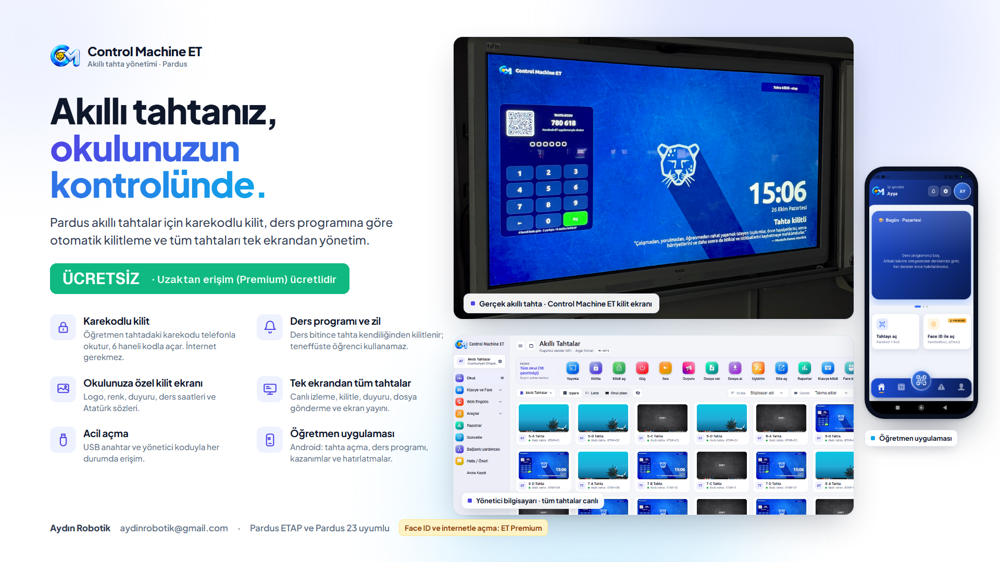
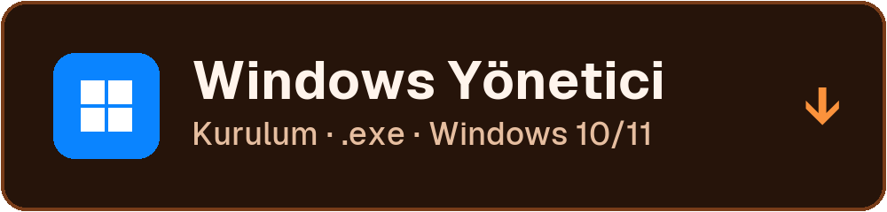

<p align="center">
  <a href="../../releases/latest"></a>
</p>

<p align="center">
  <a href="../../releases/latest"></a>
  
</p>

<p align="center">
  <a href="#ücretsiz-olanlar"></a>
</p>

<p align="center">
  <a href="https://github.com/caglargulcek/ControlMachineET/releases/download/v0.1.92/ControlMachine-ET-Kurulum-0.1.92.exe"></a>
  <a href="https://github.com/caglargulcek/ControlMachineET/releases/download/v0.1.92/ControlMachine-ET-Pardus-Kurulum-0.1.92.deb"></a>
  <br>
  <a href="https://github.com/caglargulcek/ControlMachineET/releases/download/v0.1.92/ControlMachine-ET-Android-Ogretmen-1.0.19.apk"></a>
  <br><a href="../../releases/latest">Sürüm notları</a>
</p>

> 🎁 **Control Machine ET ücretsiz.** Okulun bir yönetici bilgisayarında süre sınırı olmadan, ücret ödemeden kullanılır.
> **Premium isteyenlere ücretlidir:** en büyük farkı, tahtalar farklı ağlarda olsa da hepsini internet üzerinden yönetmektir.

---

## Videolar

<table>
  <tr>
    <td align="center" width="50%">
      <a href="https://www.youtube.com/watch?v=zBdeXcIA0-A"></a><br>
      <b>▶️ <a href="https://www.youtube.com/watch?v=zBdeXcIA0-A">Tanıtım videosu</a></b>
    </td>
    <td align="center" width="50%">
      <a href="https://www.youtube.com/watch?v=pZ9a1sGNJ24"></a><br>
      <b>▶️ <a href="https://www.youtube.com/watch?v=pZ9a1sGNJ24">Kurulum videosu</a></b>
    </td>
  </tr>
</table>

## Ücretsiz olanlar

Okulun **bir yönetici bilgisayarıyla** aşağıdakilerin hepsi **ücretsizdir**:

- **Karekodlu kilit** — Öğretmen tahtadaki karekodu telefonla okutur, tahta açılır; internet gerekmez.
- **Kodla ve USB anahtarla açma** — 6 haneli kod, USB anahtar ve yönetici koduyla acil açma.
- **Ders programı ve zil** — Ders bitince ve zil çalınca tahta kendiliğinden kilitlenir; teneffüste öğrenci tahtayı kullanamaz.
- **Okulun zil sesi** — Okulun zil saatleri ve zil sesi tahtalarda.
- **Gün sonu** — Gün sonunda tahtalar kilitli kalır.
- **Kilit ekranı** — Okul adı, logo, saat, ders bilgisi, idare duyuruları ve Atatürk sözleri; görseli ve renkleri siz seçin.
- **Tek ekrandan yönetim** — Okuldaki bütün tahtaları tek ekranda görün; bir tahtayı, birkaçını ya da hepsini tek tıkla kilitleyin ve açın.
- **Duyuru** — Tüm tahtalara aynı anda duyuru gönderin.
- **Site ve dosya** — Yönetici ekranından tahtada site açın, dosya verin.
- **Deneme sınavı sayacı** — Tahtalar geri sayıma geçer, sınav boyunca kilitli kalır.
- **Canlı izleme ve uzaktan kontrol** — Tahta ekranlarını canlı görün, uzaktan yardım edin; kare hızını ayarlayın.
- **Kelime denetimi** — Uygunsuz bir pencere açılırsa uyarı.
- **Öğretmenler** — Öğretmenleri ekleyin, her öğretmene kendi karekodunu verin.
- **Öğretmen telefon uygulaması** — Kendi ders programını girin, okulun sınıf listesini sunucudan çekin, haftalık kazanımları görün.
- **Windows ve Pardus** — Pardus ETAP 23 / 25 tahtalar; Windows ya da Pardus yönetici bilgisayarı.
- **Tüm güncellemeler** — Yeni sürümler ücretsiz gelir.

## Premium (isteyenlere ücretli)

> ⭐ **En büyük fark: tahtalar farklı ağlarda olsa da yönetin.**
> Ücretsiz sürüm okul ağındaki tahtaları yönetir. Premium ile tahtalar ayrı ağda, hatta okulun interneti farklı olsa da
> hepsi internet üzerinden tek ekranda.

Ücretsiz olanların hepsi, artı:

- **Farklı ağlardaki tahtaları internet üzerinden yönetme**
- **Face ID ve parmak iziyle** tek dokunuşla açma
- **Telefonun kendi interneti üzerinden** açma ve kilitleme
- **Okul dışından** kilitleme, açma ve duyuru gönderme
- **Telefondan tahtaya site ve dosya gönderme** (flash belleğe gerek yok)
- **Açtığınız tahtanın görüntüsünü** telefonda görme
- **Telefondan arıza bildirimi**

## Ücretler

| | |
|---|---|
| **Bir yönetici bilgisayarı** | **Ücretsiz**, süre sınırı yok |
| **Her ek yönetici bilgisayarı** | Yıllık 400 TL |
| **Premium** | Okul başına yıllık 1.600 TL (bir yönetici bilgisayarı dahil) |

Control Machine lisansı Control Machine ET'yi açmaz; iki program ayrıdır.

<sub><b>Premium neden ücretli?</b> Ücretsiz sürüm tamamen okulunuzun ağında çalışır ve bize gideri yoktur. Premium'da tahtaların farklı ağlardan internet üzerinden yönetilebilmesi için her okul adına sunucu ve altyapı çalışır; bunun okul başına aylık yaklaşık 2–3 dolarlık gideri vardır. Ücretler tamamen bu giderleri ve uygulamanın ayakta kalmasını karşılamak içindir. Control Machine ET ticari bir girişim değildir; kâr amacı gütmeden, meslektaşlarımıza faydalı olmak için geliştiriliyor. — Aydın Robotik</sub>

## Sistem gereksinimleri

| | |
|---|---|
| **Yönetici bilgisayarı** | Windows 10 / 11 (64 bit) ya da Pardus 23 / 25 |
| **Akıllı tahtalar** | Pardus ETAP 23 / 25 |
| **Öğretmen telefonu** | Android |
| **Ağ** | Yönetici bilgisayarı ve tahtalar aynı okul ağında (Premium'da gerekmez) |
| **İnternet** | İlk etkinleştirme için |

## Kurulum

> Adım adım anlatım için: **[Kurulum videosu](https://www.youtube.com/watch?v=pZ9a1sGNJ24)**

### 1. Yönetici bilgisayarı
1. [Son sürüm](../../releases/latest) sayfasından **ControlMachine-ET-Kurulum-x.y.z.exe** (Windows) ya da **ControlMachine-ET-Pardus-Kurulum-x.y.z.deb** (Pardus) dosyasını indirin.
2. Dosyaya çift tıklayın, lisans sözleşmesini kabul edip kurulumu tamamlayın.
3. İlk açılışta e-posta adresinizi doğrulayın ve okul hesabını oluşturun.

> Kurulum dosyası henüz kod imzası taşımadığı için Windows **"Bilinmeyen yayıncı"** uyarısı gösterebilir:
> **Ek bilgi › Yine de çalıştır** ile devam edin.

### 2. Akıllı tahtalar
1. Yönetici programında **Güncelle › Kurulum paketi hazırla**'yı seçin.
2. Oluşan **tek kurulum dosyasını** USB bellekle tahtaya taşıyın.
3. Tahtada çalıştırın; tahta birkaç saniye içinde yönetici ekranında belirir.

### 3. Öğretmen telefonu
1. Öğretmen uygulamasını kurun (Android için [son sürüm](../../releases/latest) sayfasındaki **ControlMachine-ET-Android-Ogretmen-x.y.z.apk**).
2. Yönetici programının verdiği karekodu okutun; telefon okula bağlanır.

## Gizlilik

Tahta ekran görüntüleri **kaydedilmez**. Premium kullanılmıyorsa tahtaların yönetimi **okulunuzun ağında kalır**.
Etkinleştirmede yalnızca e-posta adresi, okul kodu ve bilgisayarın donanım kimliği lisans sunucusuna iletilir.
Ayrıntılar: [LİSANS](LISANS.md).

## Dosyayı doğrulama

Her sürümün notlarında kurulum dosyasının **SHA-256** özeti yazar. PowerShell ile kontrol edebilirsiniz:

```powershell
Get-FileHash .\ControlMachine-ET-Kurulum-0.1.92.exe -Algorithm SHA256
```

## Premium ve iletişim

- E-posta: **aydinrobotik@gmail.com**
- Instagram: **@aydinrobotik**

---

<sub>Control Machine ET kapalı kaynaklı bir yazılımdır; bu sayfa yalnızca kurulum dosyalarını ve açıklamaları içerir. © Aydın Robotik</sub>
